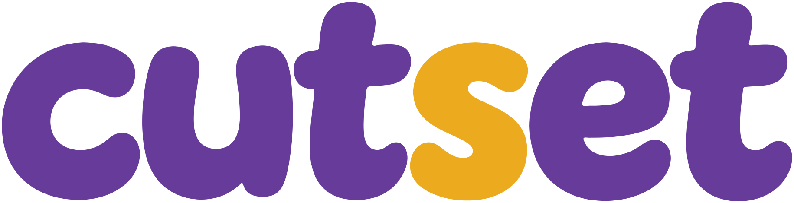

# Cutsetのロゴ

ロゴは丸みのある小文字の `cutset`。映像を切る「cut」と、編集環境を自分で組む「set」の区切りが分かるように、`set` の先頭の `s` だけを山吹色にしました。原稿の色は紫 `#673B99` と山吹色 `#ECAA1E` です。本文やメニューでは製品名を「Cutset」と書きます。[名前の由来](../architecture/product.md#cutsetという名前の由来)

## 表示する場所

README、Webの起動画面、Macのインストーラーには、6文字を横一列に並べた[SVG原稿](../../assets/app-icon/cutset-wordmark.svg)を使います。Dockやタスクバーの正方形には `cut` と `set` を上下に組みます。16px・24pxのアイコンとブラウザのタブでは、同じ原稿から紫の `c` と山吹色の `s` を取り出して使います。[各サイズの生成手順](../../assets/app-icon/README.md) ・ [DMGの背景原稿](../../packaging/macos/dmg/background.svg)

## 以前の検討案

初回のMac試用版（`0210ec7b`）には仮アイコン「Cutline」を使用しました。その後、「Split Bus」「Patch Bay」「Cut Plane」の3案を検討し、2026年11月27日に文字を主体とする現在のロゴを採用しました。[初期の比較図](images/cutset-logo-studies.png)
