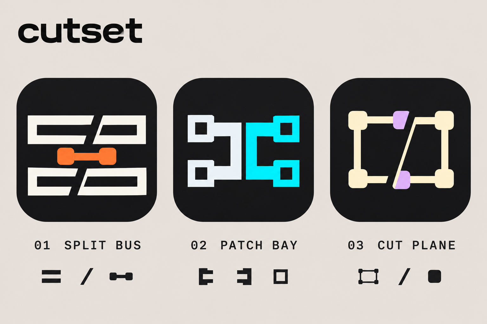

# Cutsetのロゴ案

映像のカット点と、機材の接続を選べる回路図を一つの記号にする。名前の由来は[製品の設計方針](../architecture/product.md)にまとめている。

比較用にImageGenで作成したデザイン案。正式ロゴは選定中。

| 案 | どの形に意味を持たせるか | 製品アイコンにする際の調整 |
| --- | --- | --- |
| 01 Split Bus | タイムラインを横に走る2本のトラックに同じ位置でカットを入れる。中央のオレンジは回路をつなぐジャンパー。 | 端子を少し大きくし、16pxでも2本のトラックと接点を区別できるようにする。 |
| 02 Patch Bay | シアンと白のパッチ端子を向かい合わせ、編集者が接続する機能を選べることを表す。 | 中央の隙間をそろえ、単色でも対の端子として見えるようにする。 |
| 03 Cut Plane | 映像のフレームを4つの頂点と4本の辺で描く。上辺と下辺にある接点が一対のカット点になる。 | 斜線が余分な配線に見えやすい。採用時には斜線を余白にして、上下の2か所で回路が分かれる形を試す。 |

最初に詰める候補は **Cut Plane**。長方形のフレームと編集点をそのまま回路として読める。正式採用前に16px・32px・128px、単色、明暗両方のDockで比較する。

## 試用版のアイコン

現在のDMGには、白いトラックとライム色の斜線を使った仮アイコン「Cutline」が入っている。[アイコンの原稿](../../assets/app-icon/filmcraft.svg) ・ [生成手順](../../assets/app-icon/README.md) ・ [DMGの背景](../../packaging/macos/dmg/background.svg)
